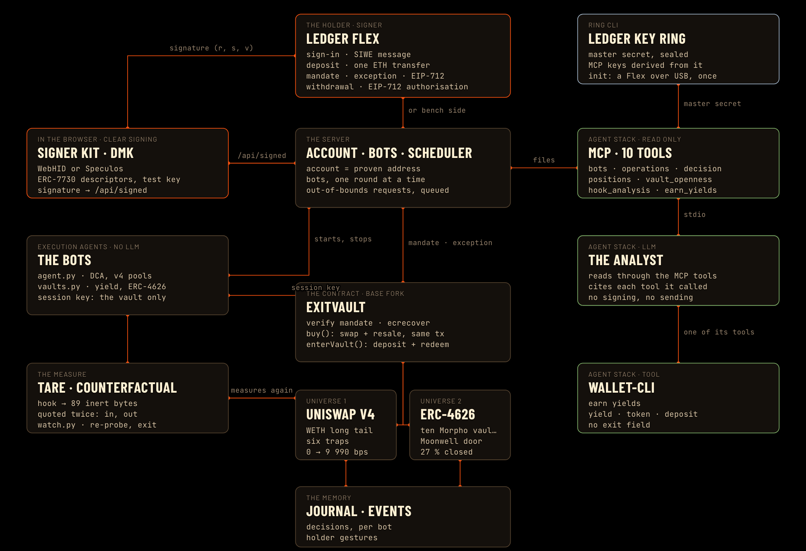

# Net·Out

**An agent cannot enter a position it cannot net out.**

Live demo: **https://netout.tech** · Code: this repository · Full README (French, with an English page): [README.md](README.md)
· Photos of a real Ledger Flex signing on the live site: [captures/ledger-reelle/](captures/ledger-reelle/)



## The problem

Agent policies bound what an agent spends: a daily cap, an allow-list, a maximum slippage. Nothing bounds what it can
get back. On Base, six real Uniswap v4 pools let you in for 0 bps and take 9,990 bps on the way out. The same hook sets
both prices, and an agent only reads the entry. Base's largest WETH yield vault had 27 % of its largest depositor's
position stuck at the block we measured. Both look fine when you enter.

## What it does

The holder signs a mandate once, on their Ledger: three numbers read in clear on the device, a budget, a tolerated exit
loss and an expiry. ExitVault, a contract in their name, applies it at every entry. It buys, simulates the full resale
in the same transaction, and reverts if the exit costs more than the mandate allows. When a purchase goes over, the
request comes back to the Ledger with the measured number. The holder reads the real exit cost and signs a single-use
exception, or leaves it refused. Funds leave the Ledger as one ETH transfer and come back on a withdrawal authorization
read in clear.

## How it works

- **The measure.** TARE, our ETHOnline 2026 instrument (finalist, Uniswap Foundation prize), swaps a hook's bytecode for
  89 inert bytes on a fork pinned at block 50,614,000 and quotes the same swap twice. Here it runs inside the vault at
  every entry and in a watcher that re-probes each position.
- **The Ledger.** Signer Kit Ethereum 1.18.1 on DMK 1.9.1, in the holder's browser, over WebHID for a real Flex or through
  Speculos. The device signs five things and never a purchase: the sign-in (SIWE), the deposit, the mandate, each
  exception and the withdrawal. Our ERC-7730 descriptors are signed with the test key of the Ethereum app 1.22.4 we
  rebuilt, so the Flex shows every field, including the exit cost.
- **The agents.** Execution bots without a language model buy through a session key that can only use the vault. An
  analyst, a language model on ten read-only MCP tools (one of them is Ledger's `wallet-cli earn yields`), explains each
  decision and names the tool behind every number. It cannot sign, send or stop anything.
- **The site.** A live map of the system lit by the bench, a door for the Ledger, pages for trades and for the account.

## Run it

Online: open https://netout.tech, click **Sign in with the emulated Flex**, and follow the card above the Flex. A real
Ledger works from Chrome, Edge or Brave, with the Ethereum app built with the test key.

Locally, with Docker, Foundry, Python 3.12+, Node 20+ and a Base RPC URL:

```bash
git clone https://github.com/JeanBaptisteDurand/Ledger && cd Ledger
git clone https://github.com/JeanBaptisteDurand/ETH_Online_2026 ../ETH_Online_2026   # the TARE corpus
cp ../ETH_Online_2026/.env.example ../ETH_Online_2026/.env                            # then set BASE_RPC_URL
ledger/build/build-flex.sh                      # app-ethereum 1.22.4 with the test key, about 5 min
(cd contracts && forge install)
uv venv .venv && . .venv/bin/activate
uv pip install -e ledger/build/app-ethereum/client -r ledger/requirements.txt
(cd ledger/dmk && npm ci)
scripts/site.sh                                 # the fork, the emulated Flex, the server and the site: http://127.0.0.1:5173
```

Details, tests and limits: [README.md](README.md). How the live site is served: [DEPLOY.md](DEPLOY.md).

## Developer feedback

[FEEDBACK.md](FEEDBACK.md), and what we filed on 13 October: LedgerHQ/device-sdk-ts
[#1987](https://github.com/LedgerHQ/device-sdk-ts/issues/1987) and [#1988](https://github.com/LedgerHQ/device-sdk-ts/issues/1988),
LedgerHQ/speculos [#685](https://github.com/LedgerHQ/speculos/issues/685), and ethereum/ERCs
[#2069](https://github.com/ethereum/ERCs/pull/2069). The chainId bug we hit in app-ethereum's Python client was proposed
the day before in [#1114](https://github.com/LedgerHQ/app-ethereum/pull/1114).

## Team

Jean-Baptiste Durand and Florent Belotti, 42 Paris (42Blockchain).
