# Net·Out

**An agent cannot enter a position it cannot net out.**

### Live demo — **<https://netout.tech>**

The whole site, with the bench behind it: a Base fork pinned at block 50,614,000, an emulated Ledger Flex (Speculos,
running the Ethereum app built with the test key) and the account server. **Sign in with the emulated Flex** connects
in one click. The Flex appears next to the page whenever it waits for a signature, and you sign on it with the mouse: a
click taps, a drag to the left turns the page, a long press signs. Then the live map: the vault, the deposit, the
mandate, the bots, the requests out of bounds, the TARE panel, the withdrawal. [Route by route](#the-site-route-by-route)
· how it is served: [`DEPLOY.md`](DEPLOY.md).

What this domain does not give is one Flex per visitor. There is one, emulated and shared: everyone who picks it is the
same holder, it signs one thing at a time, and a screen abandoned mid-review is rejected by the bench after three
minutes. A real Ledger over USB (Chrome, Edge or Brave) opens its own account, if it runs the Ethereum app built with the
test key ([prerequisites](#prérequis), in French). That path was replayed online on 13 October, photos below.

Locally, one command does the same: `scripts/site.sh`, then **<http://127.0.0.1:5173>**. `PORTEUR=1 scripts/site.sh`
adds a Flex that approves every screen by itself, for a demo without a device. Every claim in this file has a command
behind it.


The site's map, as the home page shows it and the demo lights it up: the Ledger signs five things and never a purchase,
the bots buy through a session key bounded to the vault, the contract measures the exit inside every entry, and the
analyst reads and can do nothing.

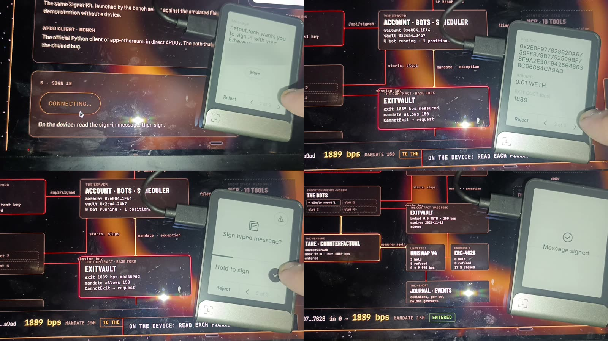

A real Ledger Flex, over USB from Chrome, on <https://netout.tech>, on 13 October: the Sign-In with Ethereum message,
then an exception read in clear whose screen shows **EXIT COST (bps) 1889**, the number the contract had just measured
on the map, "Hold to sign", then the entry under the exception. The mandate of the same account, signed by the same
Flex, is on the map. The seven photos, described one by one: [`captures/ledger-reelle/`](captures/ledger-reelle/).

---

## Contents

| | |
|---|---|
| **The product** | [The problem](#the-problem) · [What it does](#what-it-does) · [The measure: TARE](#the-measure-tare) · [Ledger's four bricks](#ledgers-four-bricks-one-role-each) · [The agents](#the-agents-and-the-line-between-them) |
| **The evidence** | [What is proven](#what-is-proven) · [What you will see](#what-you-will-see) · [The site, route by route](#the-site-route-by-route) · [What it does not catch](#what-it-does-not-catch) |
| **Using it** | [Plug your own agent in](#plug-your-own-agent-in) · [Run it](#run-it) · [`DEPLOY.md`](DEPLOY.md) · [`MAINNET.md`](MAINNET.md) |
| **For Ledger** | [Upstream findings](#upstream-findings) · [`FEEDBACK.md`](FEEDBACK.md) · [`upstream/`](upstream/) · [`SKILL.md`](SKILL.md) · [`AGENTS.md`](AGENTS.md) |
| **The rest** | [Team](#team) · [AI attribution](#ai-attribution) · [License](#license) · [`ONE-PAGE.md`](ONE-PAGE.md) · [Full documentation, in French](#documentation-complète-en-français) |

## The problem

Agent policies bound what an agent **spends**: a daily cap, an allow-list, a maximum slippage. Ledger's Agent Policies
bound exactly that. Nothing bounds what the agent can **get back**. That goes for a token whose hook blocks the resale,
for a yield vault you only leave after a seven-day queue, and for any position taken in one transaction and left in
three weeks, or never.

On Base it is not hypothetical. Across **125,072 measurements** of Base's long tail of WETH pools, **six real Uniswap v4
pools let you in for 0 bps and take 9,990 bps on the way out**, and before buying they look like 77 healthy pools. The
same hook sets both prices, and an agent only reads the entry. On the yield side, the ERC-4626 standard writes the trap
itself (`previewRedeem` must ignore withdrawal limits): at the block we measured, **Base's largest WETH vault had 27 % of
its largest depositor's position locked**, and five of ten real vaults refused even the deposit.

## What it does

The holder signs a mandate **once**, on their Ledger: three numbers read in clear on the screen, a budget, a tolerated
round-trip loss in basis points, an expiry. A contract in their name, [`ExitVault`](contracts/src/ExitVault.sol),
applies it at **every** entry: it buys, simulates the full resale in the same transaction, and reverts if the exit costs
more than the mandate allows. For an ERC-4626 vault it performs the real deposit and redemption, reverted, and reads the
largest depositor's door.

What overflows comes back to the device **with the number**: the holder reads the real exit cost and signs a single-use
exception, or leaves it refused. If the exit worsens before execution, the exception is void. Funds leave the Ledger as
one ETH transfer, the only transaction it signs, and come back on a withdrawal authorisation read in clear.

> **The agent** chooses which position, when and how much, alone, as often as it wants, inside the mandate.
> **The human** signs once, on the Flex: the budget, the tolerated round-trip loss, the expiry.
> **The contract** applies it at every purchase. The agent can neither raise the threshold, nor change the rule, nor
> touch the key: for that, you go back to the device.

## The measure: TARE

The engine that measures the exit is [**TARE**](https://github.com/JeanBaptisteDurand/ETH_Online_2026), our ETHOnline
2026 instrument (**finalist, Uniswap Foundation prize "Best Uniswap Stack Contribution"**). It does not change the pool,
it changes the hook: on a fork pinned at block **50,614,000**, `anvil_setCode` replaces the hook's bytecode with 89 inert
bytes, the same swap is quoted twice, and the gap is what the hook takes, on the way in and on the way out.

Here TARE no longer runs after the fact. It runs **inside the vault, at every entry** (`buy()`: the purchase, then the
simulated resale, in the same transaction), in the watcher (`watch.py` re-probes every position and exits while it still
can), and in front of the jury, in the TARE panel of the live map.

## Ledger's four bricks, one role each

| Brick | Here |
|---|---|
| **Signer Kit + DMK** (1.18.1 / 1.9.1) | in the holder's browser (WebHID for a real Flex, Speculos for the bench): Sign-In with Ethereum, the deposit, the mandate, each exception, the withdrawal. Never a purchase. |
| **Clear signing** (ERC-7730) | our descriptors for the mandate, the exception and the withdrawal, compiled and signed with the test key of the Ethereum app 1.22.4, served to the kit by our own context module: the Flex shows every field, the kit reports `isBlindSign=false`. Checked on the emulated Flex and on a real Flex, online ([photos](captures/ledger-reelle/)). |
| **Agent Stack** (wallet-cli 2.1.0) | the analyst, a real agent: a language model (Claude through its CLI, or OpenAI's gpt-4o-mini on the live site) on a read-only MCP of ten tools, one of them Ledger's `earn yields`. It cites the tool behind every number and cannot sign anything. The same MCP is served over HTTP for the holder's own agent. [`SKILL.md`](SKILL.md) and [`AGENTS.md`](AGENTS.md) follow Ledger's skill format. |
| **Ring CLI** (Ledger Key Ring Protocol) | the master secret every account's MCP key is derived from (`HMAC-SHA256(master, address)`, never stored). [`scripts/ring-seal.sh`](scripts/ring-seal.sh) seals it under the operator's seed. Initialised on 13 October with a real Flex over USB on the operator's Mac, where the MCP decrypts it at startup. The server behind netout.tech has no Ledger plugged in, so there the secret is a plain file. |

Line by line, with versions and files: [les briques Ledger du brief](#les-briques-ledger-du-brief-ligne-à-ligne), in
French.

## The agents, and the line between them

The **bots** act without a language model. The holder names, starts and stops each one, with its own universe (v4 pools
or ERC-4626 vaults), size and pace. They choose on what they see (depth, entry price, advertised yield) and never see
the exit, and their key can only call the vault. The **analyst** understands: it is the real agent, and it can do
nothing. The one that acts has no LLM, and the one with an LLM cannot act. An injected instruction can make a bot
*choose* a trap. It cannot make it *exceed* the mandate.

## What is proven

On a Base fork pinned at block 50,614,000:

- six real Uniswap v4 traps, indistinguishable before buying (0 bps at entry, 9,990 bps at exit), refused by the vault;
- ten real ERC-4626 WETH vaults under the same mandate: the largest has 27 % of its biggest depositor's position
  locked, five refuse deposits outright;
- **38 Foundry tests in 8 suites**, all green, one of them replaying the scene with the signature that came from the
  device;
- the whole journey (Sign-In with Ethereum, mandate, bots, refusals, exception, watch-and-sell, vault exception,
  analyst, account, reconnection, deposit and withdrawal) runs in a real browser against the emulated Flex, on the
  local bench and on the live site;
- the mandate was clear-signed on a physical Flex over USB (`ecrecover` matches), and a real Flex signed the sign-in and
  an exception on the live site.

```bash
./scripts/demo.sh                     # signs the mandate on the emulated device -> mandate.json
cd contracts
MANDATE_FILE=../mandate.json forge test --fork-url "$BASE_RPC_URL" --fork-block-number 50614000 -vv
```

## What you will see

| | |
|---|---|
|  | 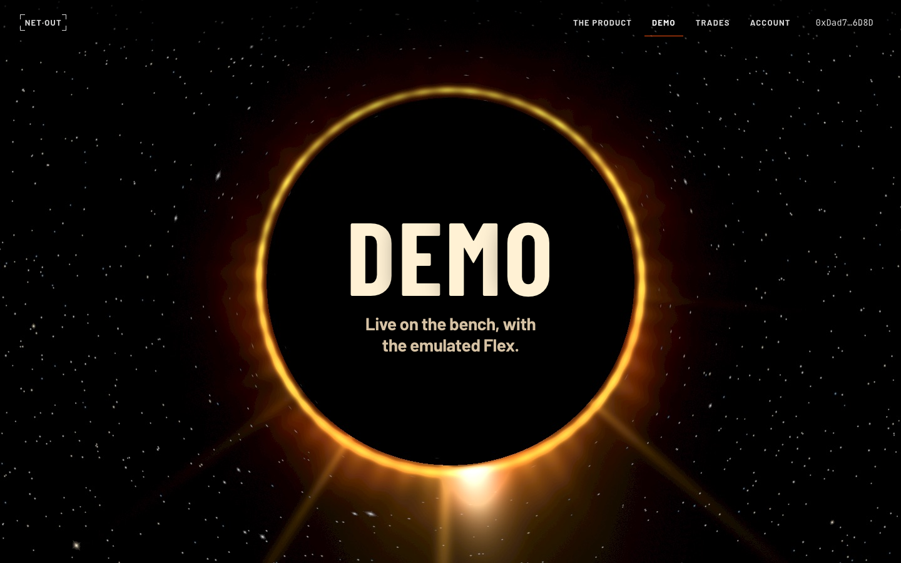 |
| The door: the emulated Flex or a real Ledger, the signing path, the sign-in. | The live map: the system lit up by the bench, the NOW card, the Flex live. |
| 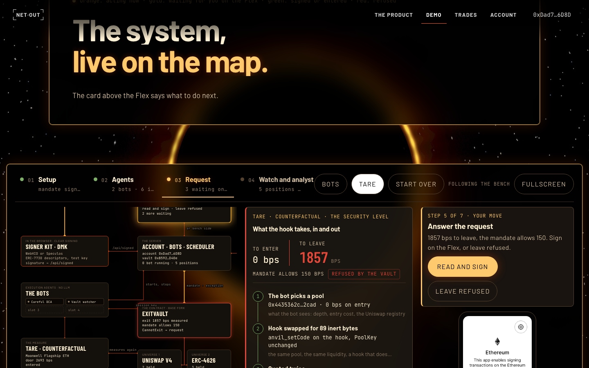 | 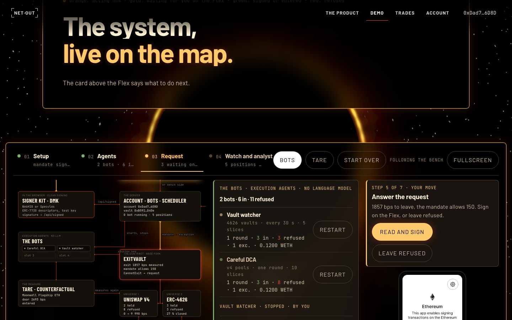 |
| TARE during a round: the four steps of the counterfactual, the number, the verdict. | The bots: each one, its numbers, its decisions, stop and restart. |
|  | 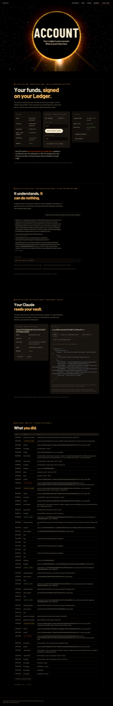 |
| Trades: the agents, the out-of-bounds requests with the device mirror, the positions, the journal. | Account: deposit and withdrawal signed on the Ledger, the analyst, the MCP key, the history. |

## The site, route by route

| Route | What it is |
|---|---|
| [`/`](https://netout.tech/) | **home**: Florent's scene, then the whole explanation, from the gap in agent policies to the map of the system |
| [`/demo`](https://netout.tech/demo) | **the live map**: the system lit up by the bench, the NOW card that says what to do, the Flex beside it, the Bots, TARE and "Watch and analyst" panels, and "Start over" |
| [`/connexion`](https://netout.tech/connexion) | **the door**: the emulated Flex or a real Ledger over USB, the signing path, the SIWE sign-in. Once signed in, come back here to switch devices |
| [`/trades`](https://netout.tech/trades) | **trades**: the agents (name, universe, slices, pace, stop, restart, history), the out-of-bounds requests with the device mirror, the positions and the re-probe, the filterable journal |
| [`/account`](https://netout.tech/account) | **the account**: deposit and withdrawal signed on the Ledger, the analyst, the MCP key with the command that plugs your own agent in, the history |

Without a proven address, `/trades` and `/account` send you to the door, which brings you back afterwards.

## Plug your own agent in

Each account has an MCP key, derived from the master secret and its address and never stored. The account page shows
it, with this command and the JSON for any MCP client that speaks HTTP:

```bash
claude mcp add --transport http netout https://netout.tech/api/mcp --header "Authorization: Bearer <your key>"
```

Your agent gets the analyst's ten read-only tools (`bots`, `operations`, `decision`, `positions`, `mandate`,
`compare_entry_exit`, `universe_facts`, `hook_analysis`, `vault_openness`, `ledger_earn_yields`), on that account only.
It can read everything and sign, send or stop nothing. An unknown key gets a 403. Nothing to install: the site serves
the MCP (`POST /api/mcp`, MCP Streamable HTTP).

## What it does not catch

A switch flipped after the purchase is watched, not prevented: the watcher re-probes every position and exits while it
can. The price of the token is not its business. And nothing here runs on a live network: the demo is a fork, and
[`MAINNET.md`](MAINNET.md) says what changes. The full list, said before anyone asks:
[ce que ça n'attrape pas](#ce-que-ça-nattrape-pas--dit-avant-quon-nous-le-demande), in French.

## Upstream findings

Building this, we hit real problems in Ledger's stack and filed them on 13 October, each checked against that day's
code: [device-sdk-ts#1987](https://github.com/LedgerHQ/device-sdk-ts/issues/1987) (`signMessage` drops any message
with one non-ASCII character), [device-sdk-ts#1988](https://github.com/LedgerHQ/device-sdk-ts/issues/1988) (the Signer
Kit detects blind signing but does not tell the developer), [speculos#685](https://github.com/LedgerHQ/speculos/issues/685)
(two clients on one emulated app get each other's answers) and [ethereum/ERCs#2069](https://github.com/ethereum/ERCs/pull/2069)
(invalid formats in the ERC-7730 example). The one-line chainId bug in app-ethereum's Python client, which breaks
EIP-712 filtering on every chain ≥ 256, had been proposed the day before
([app-ethereum#1114](https://github.com/LedgerHQ/app-ethereum/pull/1114)): we confirmed it at chain 8453. The notes,
with files and lines: [`FEEDBACK.md`](FEEDBACK.md).

## Run it

Online: open <https://netout.tech>, click **Sign in with the emulated Flex**, and follow the card above the Flex.

Locally, with Docker, Foundry, Python 3.12+, Node 20+ and a Base RPC URL:

```bash
git clone https://github.com/JeanBaptisteDurand/Ledger && cd Ledger
git clone https://github.com/JeanBaptisteDurand/ETH_Online_2026 ../ETH_Online_2026   # the TARE corpus
cp ../ETH_Online_2026/.env.example ../ETH_Online_2026/.env                            # then set BASE_RPC_URL
ledger/build/build-flex.sh                      # app-ethereum 1.22.4 with the test key, about 5 min
(cd contracts && forge install)
uv venv .venv && . .venv/bin/activate
uv pip install -e ledger/build/app-ethereum/client -r ledger/requirements.txt
(cd ledger/dmk && npm ci)
scripts/site.sh                                 # the fork, the emulated Flex, the server and the site: http://127.0.0.1:5173
```

`./scripts/demo.sh` tells the same story on the command line. Prerequisites and every option:
[prérequis](#prérequis), in French.

## Team

**Jean-Baptiste Durand** and **Florent Belotti**, École 42 Paris (42Blockchain). The contract, the bench, the agents,
the MCP, the descriptors and the upstream feedback are Jean-Baptiste's. The scene, the home page, the demo and the
site's design are Florent's. Built for the **Ledger N3XT** hackathon, 6 to 13 October 2026.

## AI attribution

Claude Code was a working tool during the hackathon, under the team's direction: the idea, the mechanism, the choices
and the design are ours. In the product, two agents use a language model, the analyst and the strategist: OpenAI's
`gpt-4o-mini` on the live site, Claude through its CLI locally. What does not come from a model is the measurements:
every exit cost comes from the Base fork at block 50,614,000, measured in the transaction by the contract or by TARE's
counterfactual, and the Foundry tests replay the refusals. The photos of the real Ledger are frames from a video of the
device.

## License

Apache-2.0 ([`LICENSE`](LICENSE)), like TARE, for the code and the texts. Not covered, and under their own terms: the 3D
models of the devices ([`front/public/references.txt`](front/public/references.txt)), Google's Draco decoder, the lens
flare of `lensflare-threejs-vanilla`, and the two sounds of the hero.

---

## Documentation complète, en français

*« Porte de sortie » est le nom de travail : les documents, le banc et les identifiants techniques l'emploient encore.*

[Le problème](#le-problème) · [Le mécanisme](#le-mécanisme) · [Le banc, dans le navigateur](#le-banc-dans-le-navigateur) ·
[L'agent, et pourquoi il se fait piéger](#lagent-et-pourquoi-il-se-fait-piéger) ·
[La seconde instance](#la-seconde-instance--dix-coffres-erc-4626-réels-même-mandat-même-refus) ·
[L'escalade](#lescalade---hors-bornes-ne-veut-pas-dire-non-) · [Plusieurs agents](#plusieurs-agents) ·
[Le MCP](#le-mcp--lecture-seule-pour-analyser-après-coup) · [L'analyste](#lanalyste--le-vrai-agent) ·
[Les briques Ledger](#les-briques-ledger-du-brief-ligne-à-ligne) · [En SaaS](#en-saas--la-ledger-reste-chez-le-client) ·
[Les mots](#les-mots-une-fois-pour-toutes) · [Ce qui tourne](#ce-qui-tourne) · [Prérequis](#prérequis) ·
[Ce que ça n'attrape pas](#ce-que-ça-nattrape-pas--dit-avant-quon-nous-le-demande) ·
[Cinq trouvailles amont](#cinq-trouvailles-amont-en-construisant-ceci) · [`VIDEO.md`](VIDEO.md) · [Licence](#licence)

## Le problème

Tu confies un budget à un agent. Tu l'as bordé : plafond, contrats autorisés, glissement maximal. Il
respecte tout — et il peut quand même prendre une position **dont il ne sortira jamais**.

Sur Uniswap v4, le *hook* d'un pool décide qui a le droit de vendre. Les 16 et 17 septembre 2026, le
registre officiel des hooks Uniswap a fusionné trois hooks dont son propre robot écrit
*« HONEYPOT WARNING … enabling a rug/honeypot after users have already bought »* — et les a classés
`vanillaSwap: true`. Dans les 125 072 mesures de [TARE](https://github.com/JeanBaptisteDurand/ETH_Online_2026), **six pools laissent entrer
pour 0 bps et prennent 9 990 à 9 999 bps à la sortie**.

- `amountOutMinimum` ne le voit pas : il borne **cet** achat, pas la revente, qui n'existe pas encore.
- Un plafond de dépense ne le voit pas : les fonds sont dépensés dans les règles.
- Transaction Check regarde le **jeton**, pas le **hook**.

**Tout le monde surveille l'entrée. Personne ne vérifie la sortie.** Et ce n'est pas propre aux
memecoins : un délai de retrait, une file d'attente, un plafond de sortie journalier ou un verrou
posent la même question, sur des marchés bien plus grands.

## Le mécanisme

1. **Le porteur signe un mandat, une fois, sur son Ledger** — lisible champ par champ :
   `Budget : 1 WETH · Max round-trip loss (bps) : 300 · Expires : …`
2. **`ExitVault` garde la règle.** L'agent n'a jamais les fonds : il appelle le coffre.
3. **À chaque achat, le coffre simule la revente intégrale dans la même transaction.** Si la sortie
   coûte plus que le mandat n'autorise — ou si le hook refuse la vente — la transaction est annulée
   avant d'exister.

La simulation est gratuite et n'écrit rien : c'est le motif du `V4Quoter` d'Uniswap
(`try poolManager.unlock(...) {} catch`, le callback revert avec son résultat). Elle revend **la
totalité** de ce qui vient d'être acheté : un piège à seuil de taille ne passe pas au travers.

## Le banc, dans le navigateur

```bash
python3 web/server.py     #  ->  http://127.0.0.1:8099
```

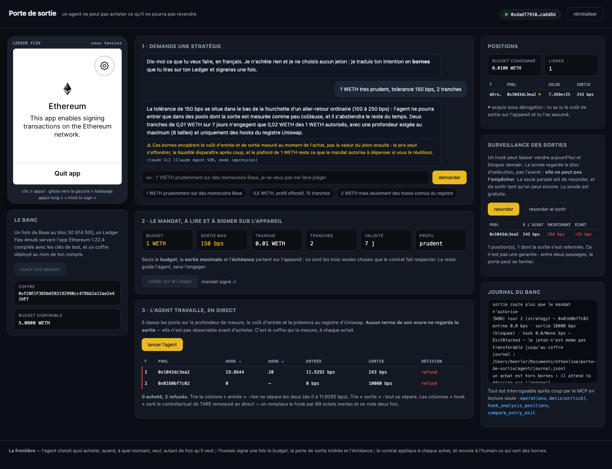

Cinq gestes, dans l'ordre :

0. **Connecte-toi avec ta Ledger.** Un compte, c'est une adresse **prouvée par l'appareil** : Sign-In with
   Ethereum signé dans ton navigateur (Signer Kit + WebHID, ou l'émulateur en banc), ou l'adresse lue sur
   l'appareil du banc. Tout ce qui t'appartient vit sous `accounts/<adresse>/` — profil, mandat, journal,
   notifications, et **ce que tu as fait** (`events.jsonl`). La carte **mon compte** montre ta **clé MCP**,
   dérivée du secret maître (`HMAC(maître, adresse)`, jamais stockée) et la configuration à coller dans ton
   Claude pour lire *ton* coffre, en lecture seule ; ses bots (actifs, arrêtés) et deux raccourcis : **gérer mes
   bots**, **parler à l'analyste** — l'analyste de ton compte, branché avec ta clé sur tes bots, tes décisions,
   tes positions. Le lien **schéma** ouvre `/schema.html` : qui fait quoi.
1. **Ouvre une session.** Un fork de Base au bloc 50 614 000, un Ledger Flex émulé servant l'app
   Ethereum 1.22.4 compilée avec les clés de test, et un coffre déployé **au nom de ton compte** —
   l'adresse prouvée à l'étape 0, pas un compte inventé.
1 bis. **Dépose depuis ta Ledger.** Un envoi d'ETH de ton adresse à ton coffre, signé sur l'appareil : la seule
   transaction que ta Ledger signe, lisible par n'importe quelle app Ethereum (montant, destinataire, frais). Le
   coffre le garde en WETH. Tu reprends tes fonds de la même carte : une **autorisation de retrait** EIP-712, lue en
   clair sur l'écran (montant, destinataire, échéance), que le banc exécute en payant le gaz, sans pouvoir y changer
   un chiffre (`withdrawWithAuthorization`, 6 tests). Sur le fork, le banc t'a mis 5 ETH fictifs, et 5 WETH de
   démonstration dans le coffre ; sur un vrai réseau, rien n'est crédité.
2. **Demande une stratégie, en une phrase.** Le CLI `claude`, ou l'API d'OpenAI en ligne, traduit ton intention en **bornes** :
   budget, coût de sortie toléré, taille de tranche, échéance. Il n'achète rien, ne choisit aucun
   jeton, et il écrit lui-même ce que ses bornes **ne** protègent **pas**.
3. **Valide sur le Ledger.** L'écran du Flex est à gauche, en direct, et **c'est toi qui l'approuves** :
   clic = appui, glissement vers la gauche = balayage, appui long = « Hold to sign ».
4. **Lance tes bots.** Un bot est un agent d'exécution sans LLM que tu nommes, que tu lances et que tu
   arrêtes : son univers (pools v4 ou coffres ERC-4626), ses tranches par tour, son rythme (un seul tour,
   ou toutes les 30 s, 60 s, 5 min). Tous tes bots travaillent dans le même coffre, sous le même mandat —
   le budget et la sortie sont tenus par le contrat, pas par eux. La carte **mes bots** montre ceux qui
   tournent (tours, achats/refus, dérogations, positions, dépensé, prochain tour), et **l'historique des
   bots arrêtés** avec leur bilan et leur motif de fin. Chaque ligne du journal porte le nom du bot ;
   quand un achat sort des bornes, la carte de dérogation le nomme : *« bot « DCA prudente » — ce pool
   coûte 387 bps à la sortie, ton mandat en autorise 150 — tu signes quand même ? »*

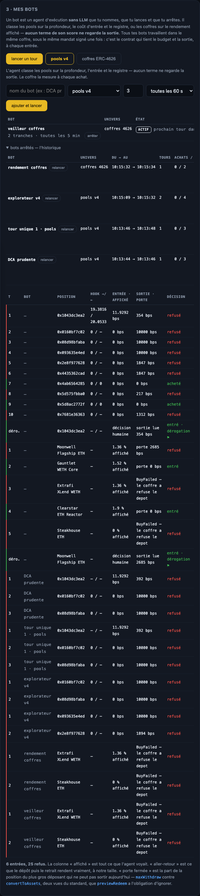

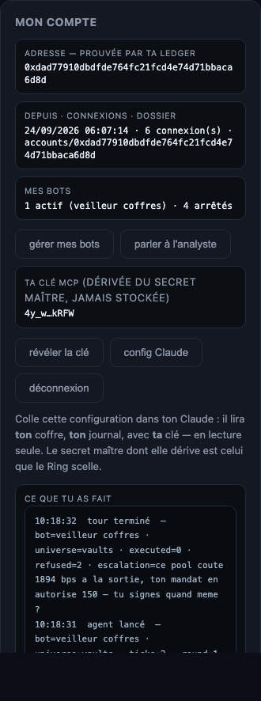

## L'agent, et pourquoi il se fait piéger

```bash
python3 agent/agent.py --ticks 6            # la stratégie choisit seule
python3 agent/agent.py --inject 0xbbe6      # une consigne injectée impose un jeton
```

La stratégie est ordinaire et défendable — c'est tout l'intérêt. Elle fait du DCA sur la longue traîne
de Base et classe les pools sur **la profondeur de mesure**, **le faible coût d'entrée** et **la présence
au registre de hooks d'Uniswap**. Aucun terme ne regarde la sortie : elle n'est pas observable avant
d'acheter.

### Ce que le hook prend vraiment — le contrefactuel de TARE, en direct

À chaque tour, on **remesure** : `anvil_setCode` remplace le hook par **89 octets inertes**, la
`PoolKey` est intacte donc le pool est identique, on cote deux fois, et l'écart est ce que le hook a
pris. Avec les mêmes gardes que TARE — relecture après écriture, sinon un `setCode` raté ferait
recoter le vrai hook et sortirait « 0 bps », la panne déguisée en mesure.

```
hook 0x963e91a451   entrant  19,96 bps   sortant     20 bps   -> sain, symetrique
hook 0x9ce0e33e68   entrant   0,00 bps   sortant  9 990 bps   -> le meme hook, cent fois plus cher a la sortie
```

On lit aussi les **permissions du hook dans les bits de sa propre adresse** — gratuit, disponible
même pour un hook absent du registre. Verdict mesuré : **ça ne discrimine pas.**
`afterSwapReturnsDelta`, le pouvoir de prélever sur la sortie, est porté par **780 pools sains sur
932** — c'est comme ça que tout hook de launchpad prend ses frais.

Ce que le corpus dit, et qui fait la démonstration :

- les pools dont on ne ressort jamais coûtent **0,00 bps à l'achat** — exactement comme 77 pools
  parfaitement sains ;
- leurs six hooks sont **absents du registre Uniswap** : ni nom, ni drapeau, ni audit ;
- donc **aucun signal disponible avant l'achat ne les distingue**.

Six tours, sortie réelle :

| tour | pool | entrée | sortie | décision |
|---|---|---|---|---|
| 1 | `0x1043dc3ea2` | 11,93 bps | 238 bps | **acheté** |
| 2 | `0x0160bf7c02` | 0,00 bps | 10 000 bps | refusé — le jeton n'est même pas transférable |
| 3 | `0x08d98bfaba` | 0,00 bps | 10 000 bps | refusé — idem |
| 4 | `0x093635e4ed` | 0,00 bps | 10 000 bps | refusé — idem |
| 5 | `0x2e8f977628` | 0,00 bps | 1 899 bps | refusé — `CannotExit` |
| 6 | `0x4435362cad` | 0,00 bps | 1 899 bps | refusé — `CannotExit` |

**Trie sur la colonne « entrée » : rien ne sépare acheté et refusé. Trie sur « sortie » : tout se sépare.**

Chaque tour écrit une ligne dans `agent/journal.jsonl` : l'univers, la liste courte avec toutes les
caractéristiques, le score et son détail, le choix, le pourquoi, la sonde, la décision du coffre, le motif.

## La seconde instance — dix coffres ERC-4626 réels, même mandat, même refus

Un coffre à rendement, c'est le standard ERC-4626 : tu déposes, tu reçois des parts, tu les rends plus
tard. **Et le standard écrit le piège lui-même** : `previewRedeem` *doit* ignorer les limites de retrait,
pendant que `maxWithdraw` peut valoir moins que la position — marché de prêt utilisé à 100 %, file
d'attente, cooldown, pause. Le rendement s'affiche, la porte est fermée.

La sonde ([`ExitVault.sol`](contracts/src/ExitVault.sol), `vaultExitLossBps`) fait deux choses, toutes
deux annulées par `revert` :

1. **l'aller-retour réel à notre taille** — `deposit` → `redeem` → mesure : ce que ça rend *vraiment*,
   pas ce que `previewRedeem` promet ;
2. **la porte** — la part de la position du **plus gros déposant** qui ne peut pas sortir aujourd'hui,
   `maxWithdraw(ref)` contre `convertToAssets(balanceOf(ref))`. Notre propre dépôt est toujours retirable
   à l'instant où on le fait (il apporte de la liquidité) ; la question honnête est : celui qui a le plus à
   sortir, peut-il sortir ?

Le pire des deux, en bps, passe par le **même champ du même mandat** (`maxRoundTripLossBps`) et le même
refus (`CannotExit`). Mesuré au bloc 50 614 000 sur les dix plus gros coffres WETH de Base (Morpho, adresses
et déposants via leur API, vérifiés sur le fork — [`Vault4626.t.sol`](contracts/test/Vault4626.t.sol)) :

| coffre | affiché | aller-retour 0,01 WETH | porte fermée | mandat à 300 bps |
|---|---|---|---|---|
| **Moonwell Flagship ETH** — 1 957 WETH, le plus gros | 1,36 % | 0 bps | **2 693 bps** (522,6 WETH de position, 381,8 retirables) | **refusé** |
| Safe × Steakhouse ETH | 1,37 % | 0 bps | 264 bps | accepté (refusé à 200) |
| Gauntlet WETH Core · Clearstar · Yearn OG | 1,5–1,9 % | 0 bps | 0 bps | accepté |
| Seamless · Extrafi · Re7 · Steakhouse · Pyth | — | **dépôt refusé** par le coffre : `AllCapsReached`, il est plein | — | — |

Et `previewRedeem` sur la position du plus gros déposant de Moonwell : **522,57 WETH** — pendant que
`maxWithdraw` dit **381,82**. Le mensonge est dans le standard, pas dans le coffre.

L'agent de rendement ([`agent/vaults.py`](agent/vaults.py)) choisit sur ce que l'API affiche — rendement,
taille, listing — et **prend Moonwell en premier**. Le coffre refuse ; la dérogation (`enterVaultUnderException`)
porte le nombre lu sur l'appareil, `EXIT COST (bps) · 2693`, à usage unique ; la sortie (`exitVault`) rend
9 999 999 999 999 999 wei sur 10¹⁶. La surveillance ([`agent/watch.py`](agent/watch.py)) resonde les deux
portes — la nôtre et celle du plus gros déposant — parce qu'un coffre ouvert à l'entrée se ferme quand les
emprunteurs prennent la liquidité : *après*, jamais *avant*. Observé dans le banc : **2 693 bps à l'entrée,
2 691 après notre dépôt** — nos 0,05 WETH ont entrouvert la porte de deux points.

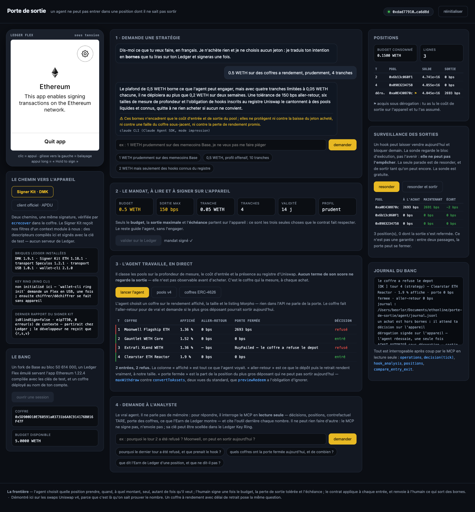

## L'escalade — « hors bornes ne veut pas dire non »

C'est la seconde moitié du modèle de Ledger : *« si un agent tente une action hors de ces bornes,
elle est automatiquement renvoyée à l'humain pour approbation »*. Le coffre ne se contente donc pas
de refuser : il prépare une question.

Le porteur lit sur son Flex, en clair :

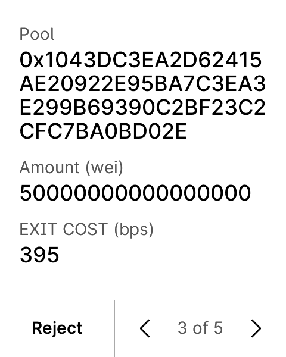

et signe — ou non — une **dérogation à usage unique**, liée à ce pool, ce montant, et **au nombre
qu'il vient de lire**. Six tests couvrent ce qu'elle ne permet pas :

```
test_1  refusé par le mandat, puis autorisé par la dérogation
test_2  une dérogation ne sert qu'une fois
test_3  la sortie a empiré depuis l'écran -> la dérogation ne vaut plus
test_4  une dérogation pour un pool ne vaut pas pour un autre
test_5  une dérogation n'est pas un blanc-seing : le budget s'applique toujours
test_6  une dérogation signée par quelqu'un d'autre ne vaut rien
```

Et une sortie **bloquée** (jeton non transférable, 10 000 bps) n'est jamais négociable : aucune
dérogation ne rend un jeton transférable, donc la question n'est même pas posée.

## Plusieurs agents

Le coffre l'est déjà, sans une ligne de plus : un mandat = un agent = un budget = un seuil. Cinq
tests le montrent — budgets séparés, pas d'emprunt de mandat, seuil de sortie par agent, révocation
à la pièce depuis l'appareil. **La limite, dite franchement :** les budgets sont séparés, *la
trésorerie ne l'est pas*. Si un agent vide le coffre, l'autre est dans son mandat mais sans fonds.
Pour isoler les fonds, il faut un coffre par agent.

## Le MCP — lecture seule, pour analyser après coup

Il ne lance rien, ne signe rien, n'envoie aucune transaction. Il sert **les données qui ont mené aux
décisions**, pour les analyser avec Claude.

```bash
python3 mcp/pds_mcp.py --print-key      # la clé, créée au premier appel
python3 mcp/pds_mcp.py --selftest       # les six outils, à vide
```

```json
{ "mcpServers": { "porte-de-sortie": {
    "command": "python3",
    "args": ["/chemin/porte-de-sortie/mcp/pds_mcp.py"],
    "env": { "PDS_MCP_KEY": "<la clé>" } } } }
```

Cette configuration lance le MCP en stdio, sur la machine du banc : elle sert à qui fait tourner le banc chez lui.
Sans rien installer, le site sert le même MCP en HTTP : `POST /api/mcp` (transport Streamable HTTP de MCP, réponses
JSON), ouvert par `Authorization: Bearer <la clé MCP du compte>`, celle que montre la page
[`/account`](https://netout.tech/account), dérivée du secret maître et jamais stockée. Les dix outils de l'analyste,
sur ce compte seulement : aucun ne signe, n'envoie ni n'arrête rien.

```bash
claude mcp add --transport http netout https://netout.tech/api/mcp --header "Authorization: Bearer <la clé>"
```

En local, même chemin : `http://127.0.0.1:5173/api/mcp`. La page `/account` donne cette commande
et le JSON (`"type": "http"`, l'URL, l'en-tête `Authorization`), chacun avec son bouton de copie.

| outil | ce qu'il rend |
|---|---|
| `operations` | les opérations tentées, l'issue et son motif |
| `decision(tick)` | **tout** ce qui a mené à une décision : univers, liste courte, scores et leur détail, sonde, mandat, issue |
| `positions` | ce que le coffre détient, le budget consommé, ce qui reste |
| `mandate` | le mandat signé sur le Ledger et ce qu'il autorise |
| `universe_facts` | pourquoi un piège est indiscernable avant l'achat, chiffres à l'appui |
| `compare_entry_exit` | entrée contre sortie, opération par opération |
| `hook_analysis` | ce que chaque hook prend, **remesuré en direct** par le contrefactuel de TARE, dans les deux sens |

Le banc écoute sur le port **8099** (`PORT=… python3 web/server.py` pour en changer) : 8080 est trop
souvent pris par un conteneur qui traîne, et une démo qui tombe sur la page de quelqu'un d'autre n'est
pas une démo.

Chaque appel exige la clé. Sans elle : `clé refusée`.

## L'analyste — le vrai agent

Les agents de swaps et de rendement sont la **démonstration de l'outil** : des stratégies ordinaires qui se
font piéger, pour montrer que le coffre les rattrape. **Le vrai agent, c'est l'analyste**
([`agent/analyst.py`](agent/analyst.py)) : un modèle (Claude, par le CLI `claude` — le Claude Agent SDK)
qui, pour répondre, **interroge nos outils** au lieu de parler de mémoire. Il n'a accès qu'au MCP en
lecture seule (`--strict-mcp-config`, rien d'autre n'est chargé) et cite l'outil derrière chaque nombre.

Sur le site en ligne, le même analyste tourne sur l'API d'OpenAI (`gpt-4o-mini`) : le banc lance le même serveur MCP
avec l'environnement du compte, donne ses dix outils au modèle comme des fonctions, et garde la même trace des outils
sous chaque réponse. `PDS_LLM=openai` le choisit, `OPENAI_API_KEY` l'ouvre ; le stratège suit la même règle.

```
$ python3 agent/analyst.py "pourquoi le tour 2 a-t-il ete refuse, et que prenait son hook ?"

Le tour 2 a été refusé par le coffre (`decision`, « REFUSED_BY_VAULT ») : la sonde a simulé un achat
puis une revente intégrale, et la revente a échoué (0x90bfb865), d'où 10 000 bps et le motif « ExitBlocked ».
La stratégie avait choisi ce pool (hook RwagmiHookV2, score 97,0) parce qu'il mesurait bien sur 8 tailles,
entrait à 0,0 bps et figurait au registre ; aucun terme du score ne regarde la sortie. Côté hook, le
contrefactuel TARE (`hook_analysis`) donne 0,00 bps à l'entrée ; à la sortie la mesure est NOT_MEASURABLE :
la cotation avec le hook a reverté. […] La vérité terrain note toutefois `is_one_way_trap: false`.

— outils consultés : decision(tick=2), hook_analysis(tick=2)          (30 s)
```

Trois garanties, par construction : il ne peut **rien faire** (le MCP ne signe pas, n'envoie pas, ne lance
rien) ; il n'a **que nos outils** ; la clé qui ouvre le MCP est **scellée dans le Ledger Key Ring**, en local sur le
Mac de l'opérateur (pas sur le serveur en ligne, qui n'a pas de Ledger branchée).
C'est la brique « Agent Stack » du brief faite pour de vrai : leur `wallet-cli` lu (`ledger_earn_yields`),
leur format de skills adopté ([`SKILL.md`](SKILL.md)), et un agent qui raisonne sur des données mesurées.
Dans le banc : carte « 4 · demande à l'analyste » — **une conversation** (l'historique lui est redonné à chaque
tour, « et celui d'avant ? » marche), et sous chaque réponse **la trace des appels MCP**, outil et arguments,
comme dans un client MCP. Il ne peut rien faire d'autre que lire : c'est la garantie, et elle est visible.

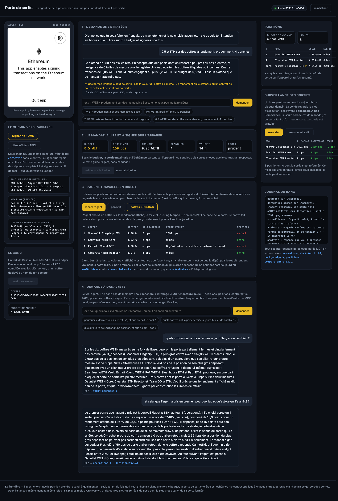

## Ce que la démo en ligne de commande montre, dans l'ordre

| | |
|---|---|
| **0** | le coffre naîtra à une adresse connue d'avance — c'est le `verifyingContract` que l'appareil verra |
| **1** | un Ledger **Flex** émulé (Speculos) sert l'app Ethereum 1.22.4 compilée avec les clés de test |
| **2** | le porteur lit et **signe le mandat sur l'appareil**, avec **nos** filtres EIP-712 — sans `originToken`, sans partenariat, **aucun serveur Ledger contacté** |
| **3** | sur le fork : l'agent achète seul un pool sain (sortie 198 bps, accepté) ; il lit une page piégée et vise un jeton qu'on ne peut même pas revendre (sortie 10 000 bps, jeton non transférable) → **refus**, budget inchangé |

Sortie réelle du dernier passage :

```
=== 1. Le mandat vient du Ledger ===
   porteur (signature verifiee sur la chaine) : 0xDad77910DbDFdE764fC21FCD4E74D71bBACA6D8D
   agent autorise                             : 0x70997970C51812dc3A010C7d01b50e0d17dc79C8
   perte aller-retour maximale                : 300 bps

=== 2. L'agent achete seul, dans le mandat ===
   pool sain  : ACHAT ACCEPTE, 895071256029443945504 jetons recus, sortie 198 bps

=== 3. Injection : une page piegee dit a l'agent d'acheter ce jeton ===
   la sonde regarde la sortie : 10000 bps (sortie bloquee : true)
   pool piege : ACHAT REFUSE (jeton non transferable) - on n'entre pas la d'ou on ne sort pas

=== 4. Rien n'a bouge ===
   budget consomme : 100000000000000 wei (inchange). Le Flex n'a pas clignote.
```

Et sur l'écran de l'appareil (`captures/mandat-02.png`) : **`Budget · 1 WETH`**,
**`Max round-trip loss (bps) · 300`**, **`Expires · 2026-09-28`**.

## La frontière agent / humain

> **L'agent** choisit quelle position prendre, quand, à quel montant — seul, autant de fois qu'il
> veut, dans le mandat.
> **L'humain** signe une fois, sur le Flex : le budget, la perte aller-retour tolérée, l'échéance.
> **Le contrat** applique à chaque achat. L'agent ne peut ni relever le seuil, ni changer la règle, ni
> toucher à la clé : pour ça, il faut revenir à l'appareil.

## Les briques Ledger du brief, ligne à ligne

Le brief dit : *« built with Ledger's Agent Stack and/or Ring CLI, and/or by wiring in a Signer for
human-in-the-loop approval »*. Les trois sont là, et chacune fait quelque chose de réel — pas une
mention dans un README.

| le brief dit | ce qui tourne ici | ce que ça prouve |
|---|---|---|
| **a Signer** | `@ledgerhq/device-signer-kit-ethereum` **1.18.1** sur le DMK **1.9.1**, transport Speculos 1.2.1 ou USB (node-hid 1.0.1) — [`ledger/dmk/sign_typed_data.cjs`](ledger/dmk/sign_typed_data.cjs). Le kit reçoit nos filtres d'un **context module à nous**, qui sert des descripteurs compilés et signés localement ([`ledger/compile_descriptor.py`](ledger/compile_descriptor.py), clé de test `cal.pem`). Aucun serveur de Ledger. | L'écran : `Contract · Exit mandate`, `Network · Base`, `Budget · 0.2 WETH`, `Max round-trip loss (bps) · 150`, `Expires · …`, `Hold to sign`. Le rapport du kit : `isBlindSign=false · eip7730 · 0 erreur`. La signature vérifiée par `ecrecover` dans le coffre (`LedgerScene.t.sol`, vert). |
| **Clear signing** | nos descripteurs ERC-7730 du mandat, de la dérogation et du retrait, compilés et signés avec la clé de test de l'app Ethereum **1.22.4** ([`ledger/compile_descriptor.py`](ledger/compile_descriptor.py), [`ledger/build/build-flex.sh`](ledger/build/build-flex.sh)) ; servis au Signer Kit par notre context module | la Flex affiche les champs, pas un blob : `isBlindSign=false · eip7730` dans le rapport du kit, sur la Flex émulée et sur une vraie Flex (2 oct.) ; sans eux, le registre répond 403 et le kit retombe à l'aveugle sans un mot (FEEDBACK § 1) |
| **Agent Stack** | `@ledgerhq/wallet-cli` **2.1.0** en lecture ([`ledger/walletcli.py`](ledger/walletcli.py)) ; l'outil MCP `ledger_earn_yields` ; [`SKILL.md`](SKILL.md) et [`AGENTS.md`](AGENTS.md) au format de leurs skills. Le modèle qui propose est le Claude Agent SDK (`claude -p`). | `wallet-cli earn yields` rend fournisseur, jeton, rendement, lien de dépôt — et **aucun champ sur la sortie** (délai, `maxWithdraw`, coût). Le trou qu'on comble est écrit dans leur propre CLI. |
| **Ring CLI** | `wallet-cli ring` (Ledger Key Ring Protocol) scelle la clé du MCP : [`scripts/ring-seal.sh`](scripts/ring-seal.sh) ; le MCP la déchiffre au démarrage et dit d'où elle vient (`--key-status`). Le Ring a été initialisé le 13 octobre avec une vraie Flex en USB, en local sur le Mac de l'opérateur : `wallet-cli ring init --unsecure-no-password`, sans mot de passe parce que le MCP déchiffre sa clé au démarrage, sans personne au clavier ; la clé privée du membre va dans le trousseau du système. Le `.mcp-key` en clair reste à côté, en repli : le MCP préfère le Ring, et `ring-seal.sh --wipe` efface la copie en clair. | La clé de lecture de l'agent adossée à la graine du porteur, révocable depuis l'appareil. `ring-seal.sh` a scellé `mcp/.mcp-key` en `mcp/.mcp-key.ring` (AES-256-GCM, clé du Ring `porte-de-sortie-mcp`), l'a redéchiffré et l'a retrouvé identique à l'octet près ; `--key-status` répond « Ledger Key Ring (.mcp-key.ring decrypted by wallet-cli ring decrypt) ». Après l'init, `ring encrypt` et `ring decrypt` se passent de l'appareil, pas du réseau : le trustchain LKRP se restaure depuis les serveurs de Ledger. **Honnêtement** : `ring init` exige un Flex en USB, une fois — pas Speculos ; et le serveur de netout.tech n'a pas de Ledger branchée : le Ring n'y est pas initialisé, le secret maître y est un fichier en clair. |

Deux chemins vers l'appareil, une même signature : le Signer Kit (défaut) ou le client officiel
d'app-ethereum en APDU direct ([`ledger/signers.py`](ledger/signers.py), bouton dans le banc). Le second
est celui qui a trouvé le bug chainId ; le premier est celui que le brief nomme.

Et le même mandat **sans** nos descripteurs (`--blind`), comme le ferait une intégration ordinaire sans
`originToken` : l'appareil affiche *« This transaction cannot be clear-signed. Enable blind signing in
the settings »* et refuse (`0x6a80`) ; le kit rapporte `isBlindSign=true · device_rejected_context` —
à Ledger, pas au développeur, qui ne reçoit que l'erreur. L'appareil est strict. La pile est muette.
C'est le point 1 de [`FEEDBACK.md`](FEEDBACK.md), mesuré.

## En SaaS — la Ledger reste chez le client

Quelqu'un chez lui, sa Ledger, notre site. Rien à installer, aucun secret à nous confier :

1. **Il se connecte avec sa Ledger** — *Sign-In with Ethereum* (EIP-4361) : un message texte normé, signé
   sur l'appareil **dans son navigateur** (Signer Kit + WebHID), vérifié par notre serveur (nonce, adresse,
   `cast wallet verify`). Pas de compte, pas de mot de passe.
2. **Le coffre est déployé à son nom** — `owner` = l'adresse prouvée à l'étape 1 — **et c'est lui qui le remplit** :
   un envoi d'ETH signé sur sa Ledger (la seule transaction qu'elle signe), gardé en WETH. Il le vide quand il veut,
   par une autorisation de retrait lue en clair sur l'appareil, que nous exécutons sans pouvoir la modifier.
3. **Il signe le mandat dans la page** — le même Signer Kit qu'en banc, transport WebHID, notre descripteur
   servi par `/api/descriptor` ; la page rend la signature à `/api/signed`. Notre serveur ne voit jamais
   l'appareil.
4. **Il débranche.** L'agent travaille avec sa clé de session — qui ne peut appeler que le coffre, dans le
   mandat. Si notre serveur est compromis, l'attaquant hérite d'un mandat, pas d'un pouvoir ; le porteur
   révoque on-chain.
5. **Ça déborde : il est prévenu** — webhook (`PDS_NOTIFY_URL`), fichier `agent/notifications.jsonl`, bannière
   et notification du navigateur. Il revient, rebranche, lit le nombre, signe la dérogation **dans la page** —
   ou refuse.

6. **Il a un compte, et une clé pour son Claude.** `accounts/<adresse>/` : profil, mandat, journal, notifications,
   `events.jsonl` (chaque geste : connexion, session, stratégie, mandat signé, tours, dérogations signées,
   surveillance, questions à l'analyste). Sa clé MCP est **dérivée** — `HMAC-SHA256(maître, adresse)`, jamais
   écrite — et n'ouvre que *ses* fichiers (`PDS_ACCOUNT`, `PDS_JOURNAL`, `PDS_MANDATE`) ; le secret maître dont
   elle dérive est celui que le Ring scelle sur le Mac de l'opérateur (sur le serveur en ligne, sans Ledger branchée,
   c'est un fichier en clair). Il la lit sur la page **/account**, avec la commande `claude mcp add` et le JSON à
   copier : son propre agent se branche en HTTP sur `POST /api/mcp` (`Authorization: Bearer <sa clé>`), sans rien
   installer, et y trouve les dix outils de l'analyste, sur son compte seulement — rien pour signer.
   Une session par compte, plusieurs comptes par serveur ; la reconnexion (SIWE, ou l'appareil du banc)
   retrouve le coffre, le mandat, les positions — et ses bots : ceux qui tournaient reprennent.
7. **Il a des bots, pas un agent.** Il en ajoute autant qu'il veut, chacun nommé, dans un univers, à un rythme ;
   il les voit tourner, les arrête d'un clic, retrouve les arrêtés avec leur bilan. Ils partagent le mandat : le
   contrat tient le budget commun. Le MCP les expose en lecture seule (`bots`, `operations(bot=…)`) : l'analyste
   du compte répond à « que font mes bots, lequel a le plus de refus ? ».

Tout ce chemin est **exercé de bout en bout dans un vrai navigateur**, par `scripts/parcours.mjs` (Chromium
headless, le même bundle `web/dist/ledger-web.js` qui parle soit à une vraie Ledger en WebHID, soit à
l'émulateur par le proxy de même origine `/speculos/*`), avec un porteur automatique **volontairement lent :
20 s de lecture avant chaque « Hold to sign »**. Dernier passage complet, le 24 septembre : connexion SIWE
24 s · mandat signé dans la page 29 s (`isBlindSign=false · eip7730`, question « Transaction Check ? »
comprise) · dix tours pools (2 achats, 8 refus) · dérogation signée dans la page 28 s · surveillance
**354 → 808 bps, vendu** · cinq tours coffres (Gauntlet, Clearstar entrés ; Moonwell refusé, porte 2 685 bps ;
deux coffres pleins) · dérogation Moonwell signée 30 s · surveillance 2 685 → 2 683 · l'analyste répond en
33 s par quatre outils · le compte montre onze genres d'événements · déconnexion, reconnexion par l'appareil
du banc : même compte, même coffre, cinq positions. Sur le banc, bouton **« ma Ledger · navigateur »**, puis
**USB (WebHID)** ou **émulée (banc)**.

Trois limites, dites : WebHID/Web Bluetooth = Chrome, Edge, Brave (pas Firefox ni Safari) ; le Key Ring
n'apparaît pas dans ce parcours — le client n'a aucun secret à garder, c'est la brique qu'on retirerait ; et
**un seul client à la fois sur l'appareil** : une signature en attente n'est prise que par l'onglet qui l'a
demandée, parce qu'un second client pendant qu'un humain lit l'écran se fait refuser ses commandes (`0x6901`)
et, sur Speculos, croise les réponses avec la signature en cours (`FEEDBACK.md` § 8 — trouvé en laissant un onglet
du banc ouvert dans un autre navigateur).

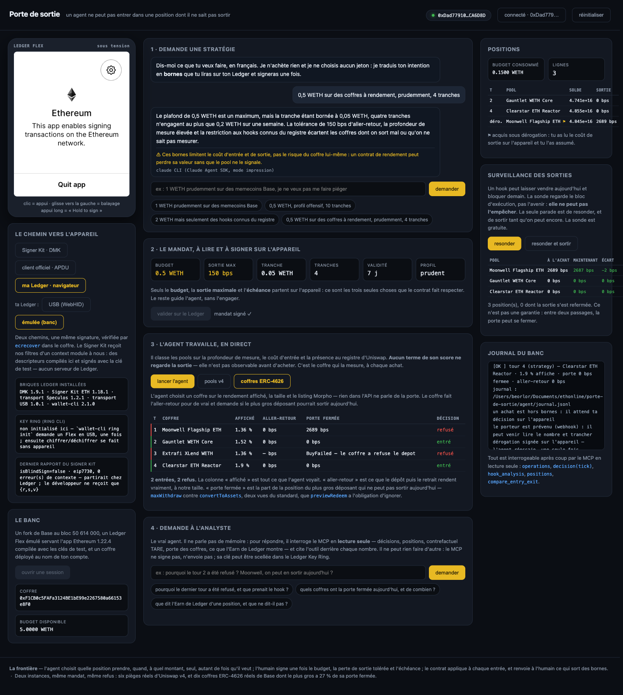

## Les mots, une fois pour toutes

| mot | ce qu'il veut dire ici |
|---|---|
| **le porteur** | la personne qui tient la Ledger ; son adresse est son compte |
| **le coffre** (`ExitVault`) | le contrat à son nom qui tient les fonds et applique le mandat à chaque entrée |
| **le mandat** | trois nombres signés une fois sur l'appareil : budget, perte de sortie tolérée (bps), échéance |
| **la sonde** | la simulation de la revente intégrale dans la transaction d'achat ; pour un coffre, le dépôt et le retrait réels, annulés |
| **le coût de sortie** | ce que perd l'aller-retour, en points de base (bps) ; 10 000 bps = tout |
| **la porte** (fermée) | la part d'une position qu'un coffre à rendement ne rend pas aujourd'hui |
| **un piège one-way** | un pool où l'on entre à 0 bps et dont on ne ressort pas |
| **la dérogation** | l'autorisation à usage unique, signée sur l'appareil avec le coût de sortie lu, pour une entrée hors mandat |
| **le dépôt, le retrait** | l'envoi d'ETH du porteur à son coffre (la seule transaction qu'il signe) ; l'autorisation EIP-712 qui lui rend ses fonds |
| **un bot** | un agent d'exécution sans modèle de langage, nommé par le porteur, qui ne voit jamais la sortie |
| **l'analyste** | le vrai agent : un modèle de langage sur dix outils en lecture seule, qui cite l'outil sous chaque nombre (Claude en local, gpt-4o-mini en ligne) |
| **le contrefactuel** (TARE) | la même cotation avec un hook inerte à la place du vrai : l'écart est ce que le hook prend |
| **le banc** | ce serveur et ces pages : un fork de Base, un Flex émulé, un compte par adresse |
| **le veilleur** | le resondage des positions tenues, et la vente de ce qui a empiré au-delà du mandat |

## Ce qui tourne

```
contracts/
  src/ExitVault.sol           le mandat et la derogation (EIP-712), les deux sondes, l'achat
  test/ExitVault.t.sol        8 tests sur fork : 6 pièges détectés, témoins acceptés, mandat borné
  test/Vault4626.t.sol        6 tests : dix coffres ERC-4626 réels (Morpho), la porte mesurée, entrée, sortie, dérogation
  test/LedgerScene.t.sol      la scène complète, avec la signature VENUE DE L'APPAREIL
  test/Escalation.t.sol       6 tests : ce qu'une dérogation permet, et tout ce qu'elle ne permet pas
  test/MultiAgent.t.sol       5 tests : plusieurs agents, plusieurs mandats, un seul coffre
  test/Exit.t.sol             5 tests : vendre, retirer, et la sonde confrontee a l'execution
  test/Withdrawal.t.sol       6 tests : le depot depuis la Ledger (ETH -> WETH), le retrait autorise par signature, ni rejeu ni modification
  test/GasProbe.t.sol         1 test  : le cout reel d'un take(), qui calibre la borne
ledger/
  speculos.sh                 lance/arrête le Flex émulé
  sign_mandate.py             mandat ET dérogation : structures EIP-712, filtres, chemin APDU, pilote Speculos
  compile_descriptor.py       compile et signe NOS descripteurs de clear signing (clé de test cal.pem)
  signers.py                  un point d'entrée, deux chemins : dmk (Signer Kit) / python (client officiel)
  walletcli.py                le wallet-cli de l'Agent Stack : earn yields, Key Ring (statut, déchiffrement)
  dmk/sign_typed_data.cjs     DMK 1.9.1 + Signer Kit ETH 1.18.1 + transport Speculos/USB + notre context module
  dmk/src/ledger-web.js       le meme Signer Kit dans le NAVIGATEUR du porteur (WebHID, ou l'emulateur par proxy) -> web/dist/
  dmk/repro_signmessage_bug.cjs  la reproduction du bug signMessage > 229 octets (FEEDBACK § 7)
accounts/<adresse>/           un compte = une adresse prouvée : profile, mandate, journal, notifications, events, bots.json
agent/
  agent.py                    la stratégie DCA (pools v4), le journal du pourquoi
  vaults.py                   l'agent de rendement (coffres ERC-4626 réels, Morpho) — il prend Moonwell en premier
  analyst.py                  LE VRAI AGENT : répond par les outils du MCP (claude -p, ou l'API d'OpenAI : PDS_LLM), jamais de mémoire
  counterfactual.py           le contrefactuel de TARE, remesuré en direct
  watch.py                    resonde les positions détenues (pools ET coffres), et sort si la porte se ferme
FEEDBACK.md                   le retour d'expérience développeur, pour Ledger Dev Rel
  journal.jsonl               une ligne par décision, avec toutes les données d'analyse
mcp/
  pds_mcp.py                  MCP lecture seule, dix outils (dont `bots`) ; clé maître (Key Ring si scellée, sinon fichier), clé par compte dérivée ; servi aussi en HTTP par le banc (`POST /api/mcp`)
web/
  server.py · index.html      le banc, un état par compte : connexion (SIWE ou appareil), mon compte, chat, mandat, mes bots (ordonnanceur, un tour à la fois), escalade nommée, analyste du compte, 3 chemins de signature
  accounts.py                 les comptes : dossier par adresse, clé MCP dérivée (HMAC), profil, événements, sessions
  schema.html                 qui fait quoi : les agents, les outils, les briques Ledger (/schema.html)
  dist/ledger-web.js          le bundle navigateur (esbuild), servi par le banc ; proxy /speculos/* meme origine
  strategist.py               une phrase -> des bornes, par le CLI `claude` ou l'API d'OpenAI (PDS_LLM)
scripts/demo.sh               la version ligne de commande, en une commande (SIGNER=dmk|python)
scripts/parcours.mjs          le parcours complet dans un vrai navigateur (Chromium headless), de la connexion à la reconnexion
scripts/porteur.py            le porteur automatique du banc (Speculos) — optionnellement lent, jamais contre un vrai appareil
scripts/reseau-reel.sh        le parcours des fonds sur un vrai réseau (Base Sepolia d'abord) : connexion, dépôt, mandat, retrait — .env.live requis
scripts/ring-seal.sh          scelle la clé du MCP dans le Ledger Key Ring (ring CLI ; un Flex en USB, une fois)
SKILL.md · AGENTS.md          le projet au format des skills de Ledger, pour un agent de code
FRONT.md                      le cahier des charges du front, écran par écran, routes et modèle de données (pour qui refait l'interface)
INTERACTIONS.md               tous les gestes de l'utilisateur : ce que fait le site, ce qui part en web3, ce que montre la Ledger, comment c'est vérifié
MAINNET.md                    du fork au réseau réel : ce qui change, dans quel ordre, avec la Ledger ; `PDS_NETWORK=live` existe (10 oct.)
upstream/                     les retours déposés chez Ledger le 13 octobre : trois tickets, une PR (textes, patch, `open.sh`)
captures/                     ce que l'appareil a affiché, page par page (dmk/ : par le Signer Kit, nos descripteurs — accueil, revue, contrat, bornes,
                              signature, et un mandat dont le budget est en USDC ; app-officielle/ : l'app de série, en brut)
front/                        le site (Vite + React) : le héros de Florent, l'explication entière et le schéma sur l'accueil, la démo,
                              la porte, puis l'espace du compte — front/APP.md
  src/app/                    le client du banc, la Ledger dans la page, le routeur : avant le compte /, /demo, /connexion ; dans le
                              compte /trades (agents, demandes, positions, journal) et /account (fonds signés sur la Ledger, analyste,
                              clé MCP, historique)
  src/components/demo/        /demo : la carte vivante allumée par le banc, la carte NOW, le volet TARE pendant un tour
  scripts/parcours-app.mjs    le parcours complet par les pages du front (Chromium headless)
scripts/site.sh               le site en une commande (banc, Flex émulée, front ; PORTEUR=1 pour une Flex qui approuve seule)
scripts/deploy.sh             le site en ligne : le front et le banc sur le serveur de netout.tech (DEPLOY.md)
deploy/                       ce que ce serveur porte : le bloc Caddy, les services systemd du banc, de sa prise Unix, du porteur
  scripts/tests-appareil.mjs  refus sur l'appareil, deux onglets du même compte, redémarrage du banc
  scripts/tests-usage.mjs     tout ce qu'une personne peut cliquer, dans l'ordre où elle le rencontre, avec les mauvaises saisies
  scripts/fetch-models.sh     les deux modèles 3D du héros (assets officiels de Ledger, non commités)
```

### Depuis un clone neuf

Rejoué le 11 octobre à 1 h du matin dans un dossier vide, en suivant ce README : `build-flex.sh` (5 min), `demo.sh`,
les 38 tests, le parcours du front avec le dépôt et le retrait signés sur l'appareil (157 s), les tests appareil (refus,
deux onglets, redémarrage), le parcours du banc (103 s) — tout est passé, avec l'app compilée sur place, en dix minutes.
Ce qui n'a pas été rejoué : la vraie Flex en USB, et le réseau réel.

### Les tests, séparément

```bash
./scripts/demo.sh                     # signe le mandat sur l'appareil émulé -> mandate.json
cd contracts
MANDATE_FILE=../mandate.json forge test --fork-url "$BASE_RPC_URL" --fork-block-number 50614000 -vv
```

`LedgerScene` rejoue la scène avec **la signature venue de l'appareil** : il lit le mandat que `demo.sh` vient
d'écrire. Sans `MANDATE_FILE`, les six autres suites passent (31 tests) et `LedgerScene` dit ce qui lui manque.

```
38 tests, 8 suites, tous verts :
  ExitVault      8   les six pièges détectés, les témoins acceptés, le mandat borné
  Vault4626      6   dix coffres réels : Moonwell refusé (porte 2 693 bps), cinq pleins, entrée/sortie/dérogation
  Escalation     6   ce qu'une dérogation permet, et tout ce qu'elle ne permet pas
  MultiAgent     5   plusieurs agents, budgets séparés, révocation à la pièce
  Exit           5   acheter, vendre, retirer — et la sonde confirmée par l'exécution réelle
  GasProbe       1   le take() reel coute 35 377 gaz, la borne est a 400 000
  LedgerScene    1   la scène complète, avec la signature venue de l'appareil
  Withdrawal     6   le dépôt depuis la Ledger devient du WETH ; le retrait autorisé par signature, exécuté par n'importe qui, jamais rejoué ni modifié
```

Le site de bout en bout, par ses pages : `front/scripts/parcours-app.mjs` (avec un porteur, ou `APPROVER=page` : à la
main, par des gestes sur la Flex que la page montre), `tests-usage.mjs`, `tests-appareil.mjs` ([`front/APP.md`](front/APP.md)).
Les mêmes tournent contre le site en ligne avec `FRONT_URL=https://netout.tech BENCH_SSH=<serveur>` ([`DEPLOY.md`](DEPLOY.md)).

## Prérequis

**Une vraie Ledger Flex** (en plus de l'émulateur) : `ledger/build/build-flex.sh` compile app-ethereum 1.22.4 avec la
clé de test (`CAL_TEST_KEY=1`, image `ledger-app-builder`, niveau d'API 26) ; `ledger/build/load-flex.sh` la charge en
USB (`ledgerblue.loadApp`) — **à la place de l'app Ethereum officielle**, que Ledger Wallet réinstalle quand on veut.
Appareil déverrouillé, Ledger Wallet fermé, accepter « Allow unsafe manager » et l'installation sur l'écran ; l'app se
lance ensuite avec un avertissement « non vérifiée ». Chargé le 2 octobre sur une Flex (OS 1.6.1, MCU 6.9.2).

**Une vraie Ledger sur le site, et ce qu'elle signe vraiment.** Sur <https://netout.tech> comme en local, elle passe par
« Real Ledger (USB) » et « My Ledger · this browser », dans Chrome, Edge ou Brave ; les chemins du banc signent toujours
sur la Flex émulée. Une Ledger déjà autorisée par le site se reconnecte sans clic. Le dépôt qu'elle signe est une vraie
transaction Base (chainId 8453), que le banc ne publie que sur le fork : elle resterait valable sur le réseau principal
tant que l'adresse y garde le même nonce et assez d'ETH. **Tester avec une adresse sans ETH sur Base.**


- **Docker** (Speculos, `ledger-app-builder`), **Foundry**, **Python 3.12+**, **Node 20+**, le CLI **`claude`** ou une clé OpenAI
  (le stratège et l'analyste), un **RPC Base** (`BASE_RPC_URL`).

  Ce qui est obligatoire, ce qui est optionnel, et ce que le banc dit quand ça manque (vérifié le 10 octobre) :

  | clé | rôle | si elle manque |
  |---|---|---|
  | `BASE_RPC_URL` (ou le `.env` de TARE) | le fork de Base | **obligatoire** — le banc démarre, et l'ouverture de session répond « BASE_RPC_URL introuvable » |
  | le CLI `claude` connecté | le stratège, l'analyste | le stratège passe en repli déterministe et le dit ; l'analyste répond que le CLI est absent, rien d'autre ne change |
  | `OPENAI_API_KEY`, avec `PDS_LLM=openai` | le stratège et l'analyste par l'API d'OpenAI (`gpt-4o-mini`, `OPENAI_MODEL` pour un autre), avec les mêmes dix outils | optionnelle ; c'est ce que le site en ligne utilise |
  | `PDS_NOTIFY_URL` | le webhook quand ça déborde | optionnelle — la page et `agent/notifications.jsonl` préviennent quand même |
  | `mcp/.mcp-key` (ou le Key Ring) | le secret maître des clés MCP | créée au premier appel ; `scripts/ring-seal.sh` pour la sceller |
  | `TARE_ROOT` | le corpus des mesures | optionnelle si TARE est cloné à côté |
- **[TARE](https://github.com/JeanBaptisteDurand/ETH_Online_2026) cloné à côté** — il fournit deux choses : le corpus
  des mesures que l'agent de pools lit (`docs/dataset/`, `docs/hooklist-live-*.json`, versionnés : un clone suffit), et le
  RPC (`.env`, d'après `.env.example`). Ailleurs : `TARE_ROOT=<chemin>` ; le RPC seul : `BASE_RPC_URL=<url>` dans
  l'environnement.

  ```bash
  git clone https://github.com/JeanBaptisteDurand/ETH_Online_2026 ../ETH_Online_2026
  cd ../ETH_Online_2026 && cp .env.example .env    # puis BASE_RPC_URL=<ton RPC Base>
  ```

  Un vrai clone, **pas un lien vers un dossier iCloud** (ni Documents, ni Bureau sur un Mac qui « optimise le stockage ») :
  iCloud évince les gros fichiers, et un bot qui lit `docs/hooklist-live-*.json` reste alors figé dans un `read()` sans
  erreur, à 0 tour et 0 % de CPU (vu le 12 octobre : `ls -lO` dit `dataless`). Même règle pour ce dépôt-ci.

- **L'app Ethereum avec la clé de test** — une seule compilation sert l'émulateur et une vraie Flex :

  ```bash
  docker pull ghcr.io/ledgerhq/ledger-app-builder/ledger-app-builder:latest   # indispensable
  ledger/build/build-flex.sh      # app-ethereum 1.22.4 (tag épinglé), CAL_TEST_KEY=1, ~5 min
  ```

  Elle sort dans `ledger/build/app-ethereum/build/flex/bin/app.elf`, que `ledger/speculos.sh` prend en premier, et
  `bin/app.hex` pour `load-flex.sh`. Testé depuis un clone neuf le 10 octobre. (Le script de TARE compile `master`, qui ne
  compile plus contre l'image du builder — FEEDBACK § 3 — et ne passe pas la clé de test : ne pas s'en servir ici.)

- Les contrats — `forge-std` est figé en sous-module, au commit avec lequel les 32 tests tournent :

  ```bash
  (cd contracts && forge install)     # ou : git clone --recursive
  ```

- L'environnement Python :

  ```bash
  uv venv .venv && . .venv/bin/activate
  uv pip install -e ledger/build/app-ethereum/client -r ledger/requirements.txt   # le client officiel, cloné par build-flex.sh
  ```

- Les briques Ledger en JavaScript — DMK, Signer Kit, transports, `wallet-cli` :

  ```bash
  (cd ledger/dmk && npm ci)     # versions épinglées dans ledger/dmk/package-lock.json
  ```

  Sans elles, tout tourne encore par le client Python (`--signer python`) ; le banc le dit.

- Le site (le héros de Florent et les pages produit) — détail dans [`front/APP.md`](front/APP.md) :

  ```bash
  (cd front && npm ci && scripts/fetch-models.sh && npm run dev)     # -> http://127.0.0.1:5173, proxy vers le banc :8099
  scripts/site.sh                # ou tout en une commande : fork, Flex émulée, serveur, front, et la porte ouverte dans le navigateur
  PORTEUR=1 scripts/site.sh      # idem, avec une Flex émulée qui approuve seule chaque écran (démo sans appareil)
  ```

## Ce que ça n'attrape pas — dit avant qu'on nous le demande

- **L'interrupteur basculé après l'achat — ça ne se corrige pas, ça se surveille.** Un hook peut
  laisser vendre aujourd'hui et bloquer demain (`erase(address)`, `tokenSet(token)` sans contrôle
  d'accès). La sonde regarde le bloc d'exécution, pas l'avenir : **elle ne peut pas l'empêcher.** La
  seule parade réelle est de **resonder les positions et sortir tant qu'on peut encore** — la sonde
  est gratuite, on la relance aussi souvent qu'on veut :

  ```bash
  python3 agent/watch.py                 # un passage, rapport
  python3 agent/watch.py --sell-if 500   # vend ce qui a empiré au-delà de 500 bps
  ```
  ```
  0x1043dc3ea2  sortie a l'achat 387 bps  ->  maintenant 960 bps  (+573 bps)   [VENDU]
  ```

  **Ce n'est pas une garantie : entre deux passages, la porte peut se fermer.** C'est une réduction de
  fenêtre, et on ne la vend pas pour autre chose.
- **Le prix.** Le mandat borne le **coût de sortie**, pas la valeur du jeton. Un agent peut acheter
  quelque chose de liquide et de mauvais.
- **La sonde de détention borne son gaz à 400 000, soit ×11 la mesure.** Un `take()` sur un jeton sain
  coûte **35 377 gaz** (mesuré sur quatre témoins, `test/GasProbe.t.sol`). La borne existe parce qu'un
  jeton piégé peut brûler **tout** le gaz qu'on lui donne en revertant : sans elle, un test passait de
  3,3 M à 1 073 M de gaz. Un jeton dont le transfert coûterait plus de 400 000 serait classé « non
  détenable » à tort — c'est un faux négatif, à ×11 de la mesure, et on préfère refuser à tort
  qu'accepter à tort.
- **La démo tourne sur un fork**, avec un Ledger émulé. Sur un Flex physique, l'app de série affiche
  déjà le mandat champ par champ (valeurs brutes) ; l'app compilée avec les clés de test, chargée par
  `ledgerctl`, l'affiche formaté comme ici. L'app de série, vue sur le Flex émulé (app-ethereum 1.22.4
  officielle, « Blind signing » et « Raw messages » activés) : six pages, tous les champs, puis *Message
  signed* — [`captures/app-officielle/`](captures/app-officielle/).
  Ce qui change sur le réseau réel, et les gestes à faire avec sa Ledger : [`MAINNET.md`](MAINNET.md).

## Cinq trouvailles amont, en construisant ceci

- **Deux clients sur une app émulée : Speculos croise leurs réponses, et une commande en attente paraît refusée.**
  Un onglet du banc oublié dans un autre navigateur, connecté au même compte, a lancé la même signature que
  la page testée : deux sessions DMK, un `B0010000` arrivé pendant que l'écran « Transaction Check ? » attendait
  le porteur. Le SDK refuse le nouveau venu (`0x6901`, `os_io_legacy.c`) et laisse la commande en attente
  tranquille : vérifié le 13 octobre contre le code du jour. C'est Speculos qui livre aussi ce refus à la requête
  qui attendait (un `APDUBridge` par requête HTTP, aucun verrou commun : 16 essais croisés sur 20), et l'invite,
  que personne n'a validée, laisse l'app attendre. Parade ici : signature en attente liée
  à l'onglet qui l'a demandée, sessions de signature sans le rafraîchisseur du DMK (`b001000000` chaque seconde,
  délai 800 ms) — et le parcours repasse avec un porteur qui met 20 s par écran (`FEEDBACK.md` § 8).

- **`signMessage` du Signer Kit jette tout message qui contient un seul caractère non ASCII.**
  Le kit dimensionne son tampon et écrit le champ longueur avec `message.length` (des caractères UTF-16), puis
  encode le message en UTF-8 (des octets) : dès qu'un « é » ou un tiret long apporte un octet de plus, l'ajout
  déborde, l'erreur est enregistrée et jamais lue, et le kit envoie un premier bloc sans un octet de message.
  L'app répond `9000` et attend, le kit échoue (`InvalidStatusWordError`) ; le message suivant est refusé
  (`0x6980`), ce refus remet l'app à zéro, et le suivant signe. On avait d'abord cru à une limite de longueur
  (~229 octets) ; rejoué le 10 octobre : 600 octets d'ASCII signent, dix « é » échouent. Notre message est en
  ASCII pur, sans `statement` (`FEEDBACK.md` § 7).
- **Le Signer Kit détecte le blind signing, le rapporte à Ledger, et ne le dit pas au développeur.**
  `BuildEIP712ContextTask` retombe en silence sur `ClearSigningType.BASIC` quand les filtres manquent ;
  `BlindSigningDetectionTask` calcule `isBlindSign`, envoie le rapport au *reporter* du context module
  et le loggue en *debug* ; la sortie de l'action est `{r, s, v}`, rien d'autre. Mesuré ici dans les deux
  sens (`--blind`, `FEEDBACK.md` § 1). Suggestion : mettre `isBlindSign` dans la sortie, à côté de la
  signature — la donnée existe déjà dans l'état interne.
- **Client Python d'app-ethereum : tout `chainId ≥ 256` casse le filtrage EIP-712.**
  `eip712/InputData.py` : `sig_ctx["chainid"].append(chainid & (0xff << (i * 8)))` — l'octet n'est pas
  redécalé, donc `bytearray.append` reçoit 0x2100 pour Base (8453) et lève `ValueError`. Leurs tests
  tournent en chainId 1. Correctif : `bytearray(chainid.to_bytes(8, "big"))`. Contourné dans
  [`ledger/sign_mandate.py`](ledger/sign_mandate.py) (`patch_chainid_bug`). Le même correctif a été proposé la
  veille de notre dépôt par un autre développeur : [#1114](https://github.com/LedgerHQ/app-ethereum/pull/1114).
- **Une image `ledger-app-builder` locale périmée casse la compilation dans l'app, pas dans l'outil.** L'app
  inclut `nbgl_icons.h` (13 août 2026) ; notre image, téléchargée avant la mi-septembre, portait un SDK Flex de
  juin. `docker pull` avant chaque build (le README d'app-builder le dit), et `-j4` plutôt que `-j` sans limite.

---

## L'équipe

**Jean-Baptiste Durand** et **Florent Belotti**, école 42 Paris. Le contrat, le banc, les agents, le MCP, les
descripteurs et les retours amont sont de Jean-Baptiste ; la scène, l'accueil, la démo et la charte du site sont de
Florent. Le moteur de mesure est [TARE](https://github.com/JeanBaptisteDurand/ETH_Online_2026), notre projet
d'ETHOnline 2026 : finaliste, prix Uniswap Foundation « Best Uniswap Stack Contribution ».

Fait pour le hackathon **Ledger N3XT** (6-13 octobre 2026). Le script de la vidéo est dans [`VIDEO.md`](VIDEO.md).

## Attribution IA

Claude Code a servi d'outil de travail pendant le hackathon, sous la direction de l'équipe : l'idée, le mécanisme, les
choix et le design sont les nôtres. Dans le produit, deux agents utilisent un modèle de langage, l'analyste et le
stratège : `gpt-4o-mini` d'OpenAI sur le site en ligne, Claude par son CLI en local.

Ce qui ne sort pas d'un modèle, ce sont les mesures : chaque coût de sortie vient du fork de Base au bloc 50 614 000,
mesuré dans la transaction par le contrat ou par le contrefactuel de TARE, et les tests Foundry rejouent les refus.
Les photos de la vraie Ledger sont des images d'une vidéo de l'appareil.

## Licence

Le code et les textes de ce dépôt sont sous licence **Apache-2.0** ([`LICENSE`](LICENSE)), comme TARE. Ne sont pas
couverts, et gardent leurs propres conditions : les modèles 3D des appareils (la Ledger Stax de rtql8d et la Ledger
Nano X de HQ3DMOD, sur Sketchfab, voir [`front/public/references.txt`](front/public/references.txt)), le décodeur Draco
de Google, le reflet d'objectif de `lensflare-threejs-vanilla`, et les deux sons du héros : la musique de Strauss est
dans le domaine public, pas forcément son enregistrement, et le vent est donné sans droits par sa source.
